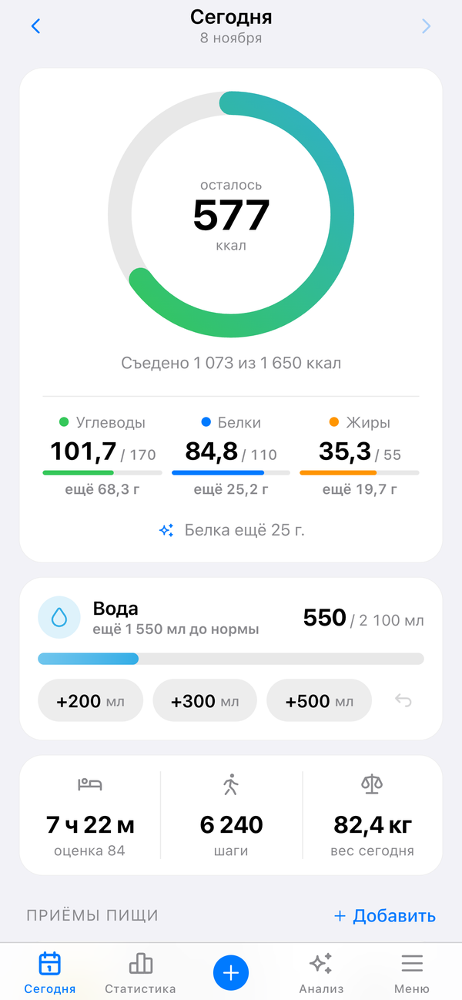
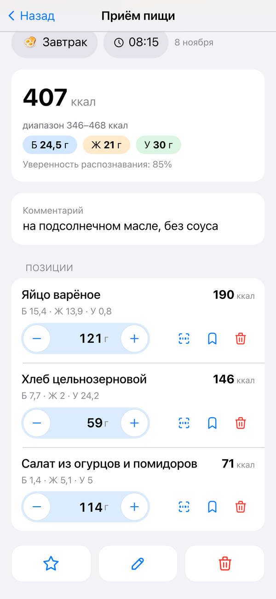
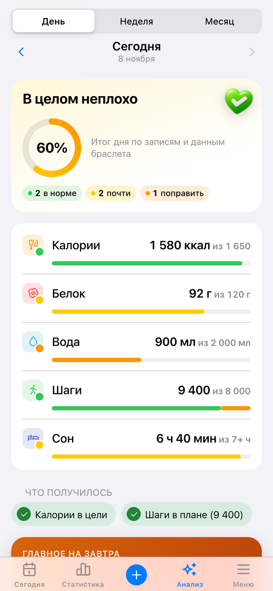
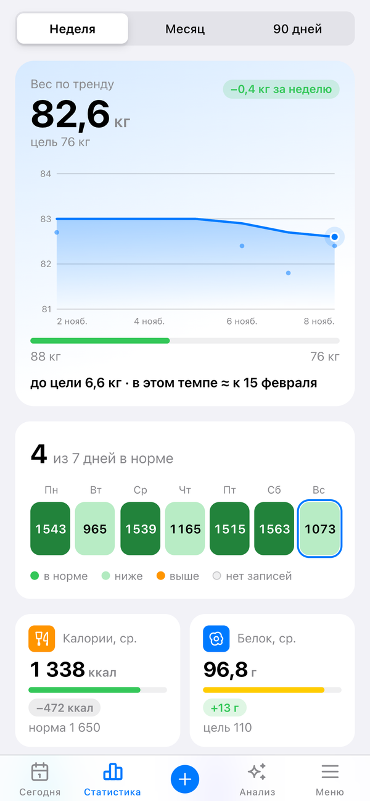
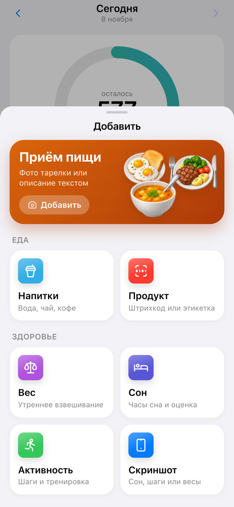
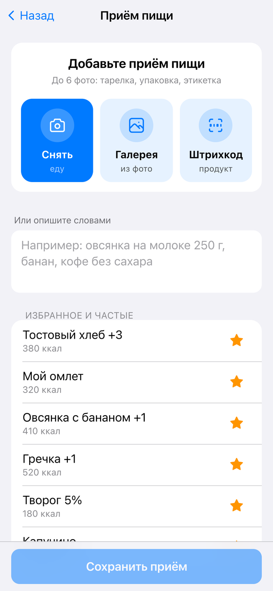
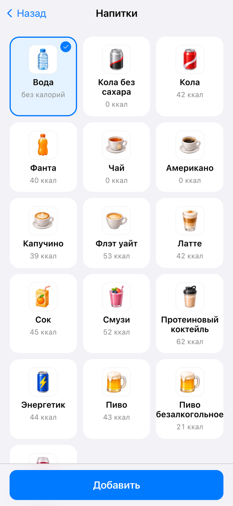
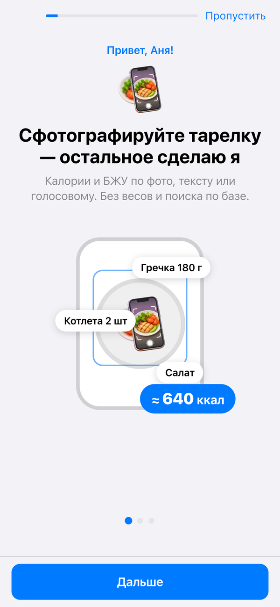
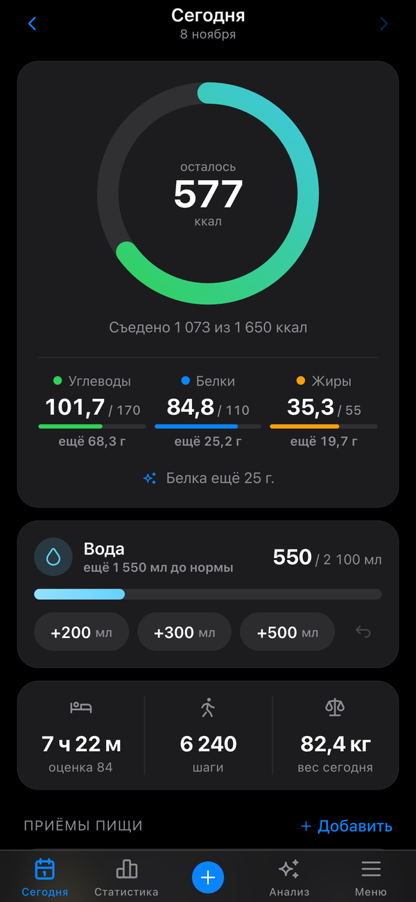

<div align="center">


# Kcalm

**Дневник питания в Telegram, который не стыдит.**
Сфотографируй тарелку, скажи голосом или напиши словами, а бот сам посчитает калории и БЖУ.
Отчёты, графики и советы живут в Mini App прямо внутри Telegram.


</div>

---

## Как это выглядит

<table>
  <tr>
    <td align="center"><br><sub><b>Сегодня</b>: сколько осталось, БЖУ, вода в одно касание</sub></td>
    <td align="center"><br><sub><b>Приём пищи</b>: позиции, граммы, диапазон калорий</sub></td>
    <td align="center"><br><sub><b>Анализ</b>: итог дня и главный шаг на завтра</sub></td>
  </tr>
  <tr>
    <td align="center"><br><sub><b>Статистика</b>: тренд веса и дни в норме</sub></td>
    <td align="center"><br><sub><b>Добавить</b>: еда, напитки, вес, сон, активность</sub></td>
    <td align="center"><br><sub><b>Новый приём</b>: фото, галерея, штрихкод или текст</sub></td>
  </tr>
  <tr>
    <td align="center"><br><sub><b>Напитки</b>: чай и кофе засчитываются в воду</sub></td>
    <td align="center"><br><sub><b>Онбординг</b>: настройка примерно за минуту</sub></td>
    <td align="center"><br><sub><b>Тёмная тема</b> подхватывается из Telegram</sub></td>
  </tr>
</table>

<sub>Скриншоты сняты с Mini App в демо-режиме (`?mock=1`), данные вымышленные.</sub>

## Что умеет

**Еда**
- 📸 **Фото тарелки**: до 6 фото на приём, альбом считается одним приёмом, подпись к фото уточняет состав.
- 🎙 **Голос и текст**: «овсянка на молоке 250 г, банан, кофе без сахара».
- 💬 **«Уточнить»**: «жарила на масле, плюс ложка майонеза», и запись правится, а не пересчитывается с нуля.
- 🏷 **Этикетки и штрихкоды**: КБЖУ с упаковки или из Open Food Facts, сохраняется в «Мои продукты».
- 🍽 **Своя посуда**: бот знает размер твоей тарелки и точнее оценивает порцию по фото.
- ⭐ **Избранное и частые блюда**: повтор обычного завтрака в одно касание.

**Тело и режим**
- ⚖️ Вес и состав тела со скриншотов весов (PICOOC и другие), тренд по 7-дневному среднему.
- 😴 Сон, шаги и тренировки со скриншотов фитнес-приложений (Mi Fitness и другие) или словами.
- 💧 Вода, при этом чай и кофе тоже засчитываются, а сок и газировка идут только в калории.
- 🎯 Цель по формулам IOM 2005, адаптивный пересчёт по реальному весу и еде (с нижним пределом).

**Поддержка**
- 🌙 **Ночная тяга к еде**: бот разговаривает спокойно, без «нельзя» и без стыда, и через 10 минут спрашивает, как ты.
- 🧭 **Анализ дня**: советы строятся правилами по твоим данным, без выдуманных цифр.
- 🫶 **Осторожный режим** (`/care`): без напоминаний о весе, темп не больше 0,25 кг в неделю.
- 🛡 **Безопасность**: 18+, ИМТ не ниже 18,5, при тревожных сигналах бот только советует обратиться к врачу.

## Главный принцип: LLM распознаёт, Python считает

Модель никогда не пишет калории. Она отвечает только на вопрос «что на тарелке и сколько примерно граммов»,
а КБЖУ считает код по базе продуктов. Поэтому цифры воспроизводимы и проверяются тестами.

```
фото / голос / текст
        │
        ▼
  LLM (DeepSeek через OpenRouter)  →  {"items": [{"name": "гречка", "grams": [150, 200]}], "intent": "meal"}
        │
        ▼
  matching: поиск по базе продуктов (свои продукты > общая база > Open Food Facts > оценка по категории)
        │
        ▼
  domain/nutrition.py  →  ккал и БЖУ с диапазоном ±20–25 %  →  SQLite / Turso
```

Если бот не уверен, он показывает диапазон («346–468 ккал»), а не делает вид, что знает точно.

## Как устроено

| Часть | Что внутри |
|---|---|
| Бот | `aiogram 3`, webhook или polling, планировщик APScheduler (вечерний и недельный пуш) |
| Mini App | `aiohttp` в том же процессе, фронт на чистом JS без сборки (`app/web/static`) |
| LLM | OpenRouter: DeepSeek для текста, фото и диалога; отдельная модель для распознавания голоса |
| Данные | SQLite локально или Turso (облачный SQLite) в продакшене, SQL-миграции |
| Отчёты | `services/insights.py` (факты и советы правилами), графики на matplotlib |
| Деплой | Render (`render.yaml`), systemd-юниты в `deploy/` для своего сервера |

```
app/
  bot.py            точка входа
  routers/          чат: приём еды, тяга, онбординг, команды
  domain/           расчёты без сети: калории, цели, вода, матчинг продуктов, безопасность
  services/         конвейер еды, скриншоты, отчёты, ассистент, разговор при тяге
  llm/              клиент OpenRouter: JSON-режим, повторы, учёт стоимости и кеша
  prompts/          все промпты в markdown
  web/              API и статика Mini App
  migrations/       SQL-миграции
tests/              968 тестов на моках, без сети и ключей
```

## Быстрый старт

```bash
git clone https://github.com/Tseende/Kcalm.git
cd Kcalm
python3.11 -m venv .venv
.venv/bin/pip install -r requirements.txt
cp .env.example .env    # TELEGRAM_BOT_TOKEN, OPENROUTER_API_KEY, ALLOWED_TG_IDS
.venv/bin/python -m app.check    # проверки без сети
.venv/bin/python -m pytest -q    # тесты
.venv/bin/python -m app.bot      # запуск
```

Посмотреть Mini App без бота и ключей, на демо-данных:

```bash
python3 -m http.server 8770 --directory app/web/static
# открыть http://127.0.0.1:8770/?mock=1  (онбординг: ?mock=1&onb=1)
```

Для Mini App внутри Telegram нужен HTTPS: `WEB_ENABLED=true` и `WEBAPP_URL`. Пошаговый деплой на Render и Turso
описан в [docs/DEPLOY_RENDER.md](docs/DEPLOY_RENDER.md).

### Основные переменные `.env`

| Переменная | Зачем |
|---|---|
| `TELEGRAM_BOT_TOKEN` | токен от @BotFather |
| `OPENROUTER_API_KEY` | ключ OpenRouter |
| `ALLOWED_TG_IDS` | кому можно пользоваться ботом (через запятую) |
| `MODEL_TEXT`, `MODEL_VISION` | модели для текста и фото (по умолчанию DeepSeek) |
| `DAILY_LLM_LIMIT` | лимит запросов к модели на человека в сутки |
| `WEB_ENABLED`, `WEBAPP_URL` | включить Mini App |
| `TURSO_DATABASE_URL`, `TURSO_AUTH_TOKEN` | облачная база вместо локального файла |
| `WEBHOOK_BASE_URL` | режим webhook вместо polling |

Полный список с комментариями лежит в [.env.example](.env.example).

## Документация

- [docs/DEVELOPMENT.md](docs/DEVELOPMENT.md): команды, схема БД, контракты LLM, эксплуатация
- [docs/README.md](docs/README.md): проектные решения
- [docs/V2_PLAN.md](docs/V2_PLAN.md), [docs/V2_API.md](docs/V2_API.md): Mini App и его API
- [docs/ONBOARDING.md](docs/ONBOARDING.md): онбординг
- [docs/DEPLOY_RENDER.md](docs/DEPLOY_RENDER.md): деплой
- [THIRD_PARTY_NOTICES.md](THIRD_PARTY_NOTICES.md): чужой код и данные, которые используются в проекте

## Важно

Kcalm не медицинское приложение и не заменяет врача или диетолога. Калории по фото считаются примерно.
Если у тебя расстройство пищевого поведения или есть сомнения насчёт здоровья, сначала обратись к специалисту.
