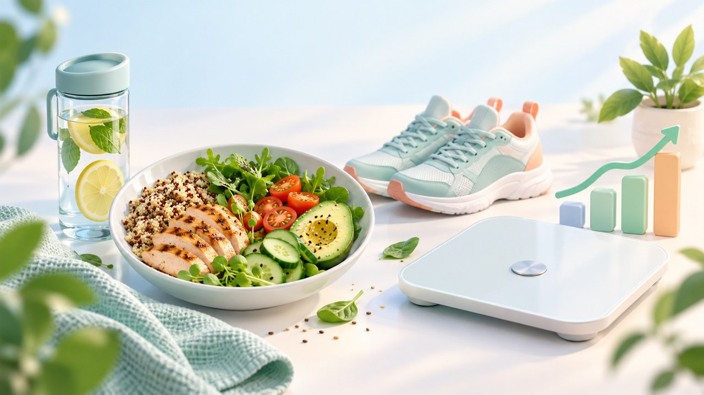
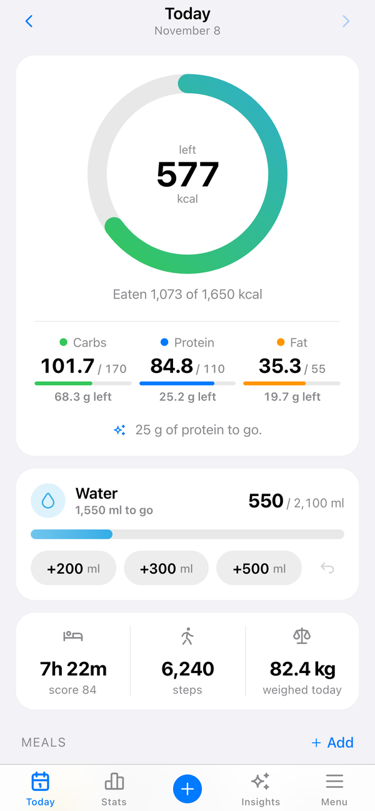
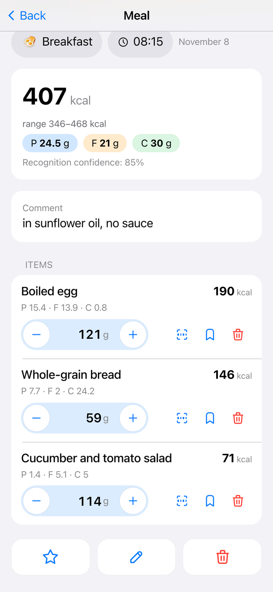
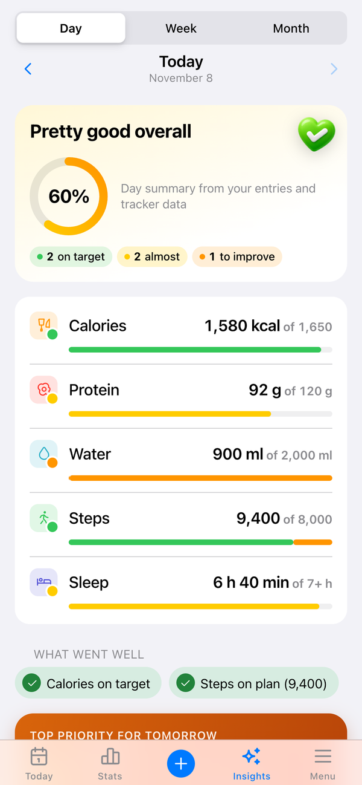
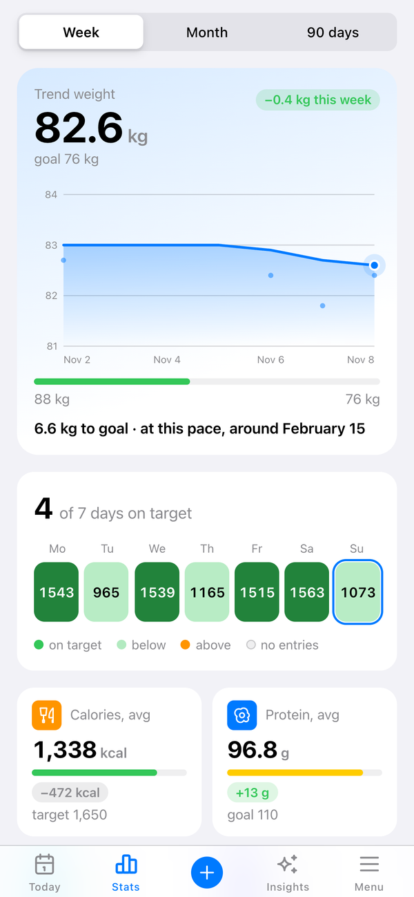
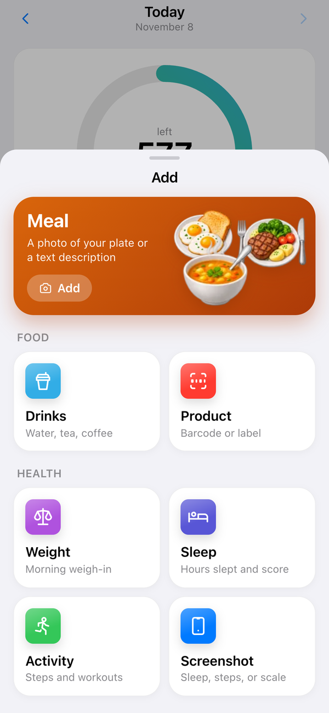
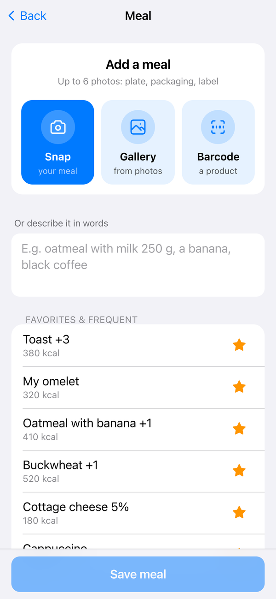
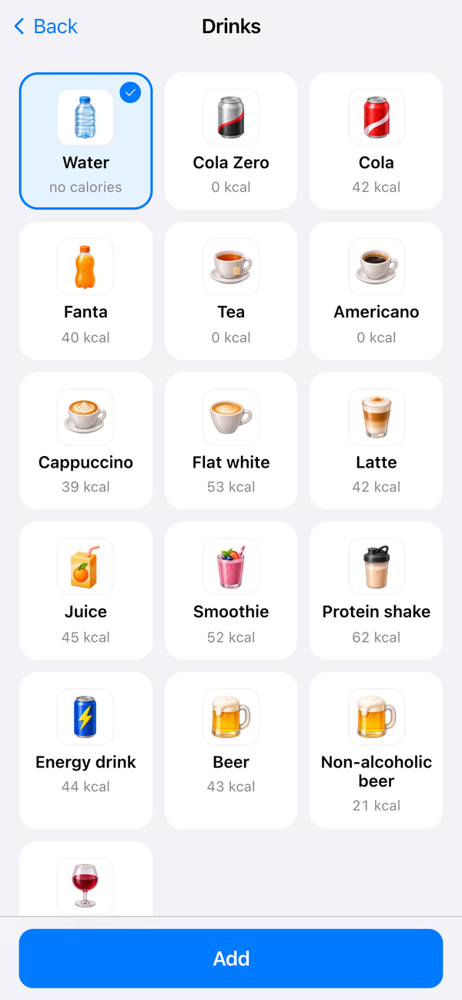
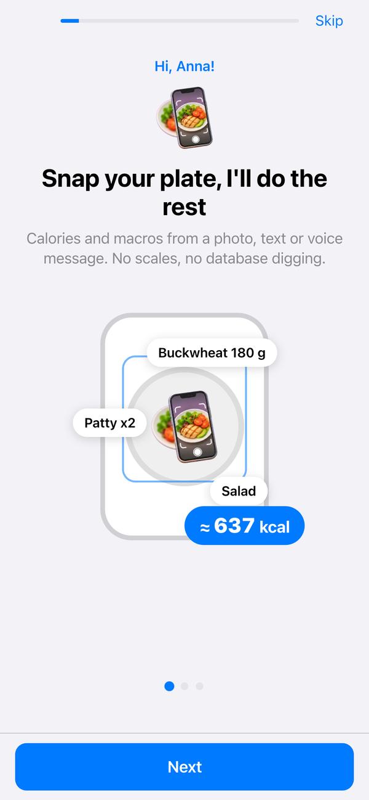
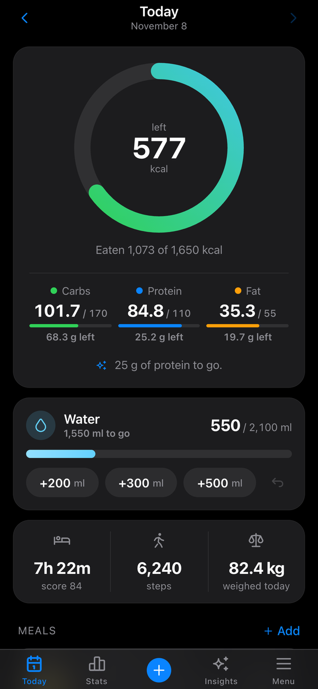

<div align="center">

**English** | [Русский](README.ru.md)



# Kcalm

**A food diary in Telegram that never shames you.**
Snap your plate, say it out loud or type it, and the bot works out calories and macros for you.
Reports, charts and tips live in a Mini App right inside Telegram.


</div>

---

## Screenshots

<table>
  <tr>
    <td align="center"><br><sub><b>Today</b>: what's left, macros, one-tap water</sub></td>
    <td align="center"><br><sub><b>Meal</b>: items, grams, calorie range</sub></td>
    <td align="center"><br><sub><b>Analysis</b>: how the day went and one step for tomorrow</sub></td>
  </tr>
  <tr>
    <td align="center"><br><sub><b>Stats</b>: weight trend and days on target</sub></td>
    <td align="center"><br><sub><b>Add</b>: food, drinks, weight, sleep, activity</sub></td>
    <td align="center"><br><sub><b>New meal</b>: camera, gallery, barcode or text</sub></td>
  </tr>
  <tr>
    <td align="center"><br><sub><b>Drinks</b>: tea and coffee count as water</sub></td>
    <td align="center"><br><sub><b>Onboarding</b>: set up in about a minute</sub></td>
    <td align="center"><br><sub><b>Dark theme</b> follows Telegram</sub></td>
  </tr>
</table>

<sub>Screenshots are taken from the Mini App in demo mode (`?mock=1&lang=en`); the data is made up.</sub>

> **Languages.** The Mini App speaks English and Russian (it follows your Telegram language, and you can switch it in
> Menu → Appearance). The chat bot itself currently talks in Russian.

## Features

**Food**
- 📸 **Plate photos**: up to 6 photos per meal, an album counts as one meal, a caption refines what's on the plate.
- 🎙 **Voice and text**: "oatmeal with milk 250 g, a banana, coffee without sugar".
- 💬 **Refine**: "fried it in oil, plus a spoon of mayo", and the entry is edited instead of recalculated from scratch.
- 🏷 **Labels and barcodes**: nutrition facts from the package or from Open Food Facts, saved to "My products".
- 🍽 **Your own dishware**: the bot knows the size of your plate and estimates portions from photos more accurately.
- ⭐ **Favorites and usual meals**: repeat your regular breakfast with one tap.

**Body and routine**
- ⚖️ Weight and body composition from smart-scale screenshots (PICOOC and others), trend on a 7-day average.
- 😴 Sleep, steps and workouts from fitness-app screenshots (Mi Fitness and others) or in plain words.
- 💧 Water: tea and coffee count too, while juice and soda only add calories.
- 🎯 Daily target from the IOM 2005 equations, adaptively recalculated from your real weight and intake (with a floor).

**Support**
- 🌙 **Late-night cravings**: the bot talks calmly, with no "you can't" and no shame, and checks in 10 minutes later.
- 🧭 **Daily analysis**: tips are built by rules from your own data, never with made-up numbers.
- 🫶 **Gentle mode** (`/care`): no weight reminders, pace capped at 0.25 kg per week.
- 🛡 **Safety**: 18+, BMI floor of 18.5, and on warning signs the bot only suggests seeing a doctor.

## Core idea: the LLM recognizes, Python does the math

The model never writes calories. It only answers "what is on the plate and roughly how many grams",
and the code computes calories and macros from a food database. That keeps the numbers reproducible and testable.

```
photo / voice / text
        │
        ▼
  LLM (DeepSeek via OpenRouter)  →  {"items": [{"name": "buckwheat", "grams": [150, 200]}], "intent": "meal"}
        │
        ▼
  matching: food lookup (your products > shared database > Open Food Facts > category estimate)
        │
        ▼
  domain/nutrition.py  →  kcal and macros with a ±20–25 % range  →  SQLite / Turso
```

When the bot isn't sure, it shows a range ("346–468 kcal") instead of pretending to know exactly.

## How it's built

| Part | Inside |
|---|---|
| Bot | `aiogram 3`, webhook or polling, APScheduler for the evening and weekly pushes |
| Mini App | `aiohttp` in the same process, plain JS front end with no build step (`app/web/static`) |
| LLM | OpenRouter: DeepSeek for text, photos and dialogue; a separate model for speech recognition |
| Data | SQLite locally or Turso (hosted SQLite) in production, SQL migrations |
| Reports | `services/insights.py` (facts and rule-based tips), charts with matplotlib |
| Deploy | Render (`render.yaml`), systemd units in `deploy/` for your own server |

```
app/
  bot.py            entry point
  routers/          chat: food intake, cravings, onboarding, commands
  domain/           offline math: calories, targets, water, food matching, safety
  services/         food pipeline, screenshots, reports, assistant, craving dialogue
  llm/              OpenRouter client: JSON mode, retries, cost and cache accounting
  prompts/          all prompts as markdown
  web/              Mini App API and static files
  migrations/       SQL migrations
tests/              968 tests on mocks, no network or keys needed
```

## Quick start

```bash
git clone https://github.com/Tseende/Kcalm.git
cd Kcalm
python3.11 -m venv .venv
.venv/bin/pip install -r requirements.txt
cp .env.example .env    # TELEGRAM_BOT_TOKEN, OPENROUTER_API_KEY, ALLOWED_TG_IDS
.venv/bin/python -m app.check    # offline checks
.venv/bin/python -m pytest -q    # tests
.venv/bin/python -m app.bot      # run
```

Try the Mini App without the bot or any keys, on demo data:

```bash
python3 -m http.server 8770 --directory app/web/static
# open http://127.0.0.1:8770/?mock=1&lang=en  (onboarding: ?mock=1&onb=1&lang=en)
```

The Mini App inside Telegram needs HTTPS: set `WEB_ENABLED=true` and `WEBAPP_URL`. A step-by-step deploy to Render
and Turso is in [docs/DEPLOY_RENDER.md](docs/DEPLOY_RENDER.md) (in Russian).

### Main `.env` variables

| Variable | Purpose |
|---|---|
| `TELEGRAM_BOT_TOKEN` | token from @BotFather |
| `OPENROUTER_API_KEY` | OpenRouter key |
| `ALLOWED_TG_IDS` | who may use the bot (comma-separated) |
| `MODEL_TEXT`, `MODEL_VISION` | models for text and photos (DeepSeek by default) |
| `DAILY_LLM_LIMIT` | per-person daily limit of model calls |
| `WEB_ENABLED`, `WEBAPP_URL` | turn on the Mini App |
| `TURSO_DATABASE_URL`, `TURSO_AUTH_TOKEN` | hosted database instead of a local file |
| `WEBHOOK_BASE_URL` | webhook mode instead of polling |

The full commented list is in [.env.example](.env.example).

## Documentation

The project docs are in Russian:

- [docs/DEVELOPMENT.md](docs/DEVELOPMENT.md): commands, database schema, LLM contracts, operations
- [docs/README.md](docs/README.md): design decisions
- [docs/V2_PLAN.md](docs/V2_PLAN.md), [docs/V2_API.md](docs/V2_API.md): the Mini App and its API
- [docs/ONBOARDING.md](docs/ONBOARDING.md): onboarding
- [docs/DEPLOY_RENDER.md](docs/DEPLOY_RENDER.md): deployment
- [THIRD_PARTY_NOTICES.md](THIRD_PARTY_NOTICES.md): third-party code and data used in the project

## Disclaimer

Kcalm is not a medical app and doesn't replace a doctor or a dietitian. Calories from photos are estimates.
If you live with an eating disorder or have any doubts about your health, talk to a specialist first.
